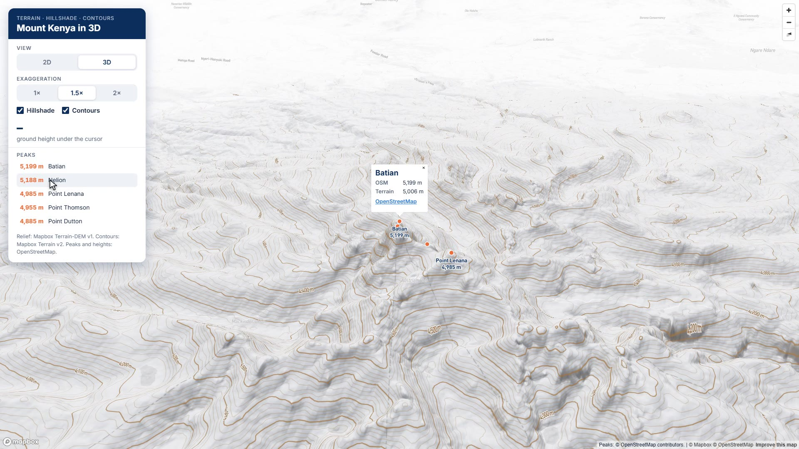

# 3D terrain, hillshade and contours in React + Mapbox (TypeScript)

Source code for the Geo Intelligence Lab video **"3D terrain, hillshade and contours in Mapbox GL JS"**.

Mount Kenya on a flat map, and one click turns it 3D: the map drapes over Mapbox's elevation tiles, hillshade
shades the slopes, contour lines wrap them, and a readout shows the height of the ground under your cursor. The
peaks and their heights come from OpenStreetMap. Built with React, TypeScript, Vite and Mapbox GL JS.



## What's inside

| Folder | What it is |
|---|---|
| [`starter/`](starter) | The broken version, with three bugs. Fix it with the video |
| [`final/`](final) | The finished app shown in the video |

The finished app covers:

- **Two tilesets, two jobs:** Mapbox Terrain-DEM v1 (`raster-dem`, heights in metres) for the 3D terrain and the
  hillshade, and Mapbox Terrain v2 (`vector`) for the contour lines
- **3D terrain:** `setTerrain({ source, exaggeration })` drapes the map over the heights, and the camera tilts,
  because relief is hard to see looking straight down
- **Hillshade from its own DEM source**, drawn with the contour lines under the basemap's labels (`beforeId`)
- **Contours:** the `contour` layer's `ele` (metres) for labels, and `index` to label only every 5th and 10th line
- **Real heights:** `queryTerrainElevation(lngLat, { exaggerated: false })`. The default (`true`) multiplies the
  height by the exaggeration: at 2×, Batian reads over 10,000 m

The three bugs in `starter/`:

1. The DEM source points at `mapbox-terrain-v2`, the contour tileset: the camera tilts but the ground stays flat,
   and the console says `Could not load image … The source image could not be decoded`
2. `source-layer` is `'contours'`; the tileset calls its layer `contour`: no lines, and
   `Source layer "contours" does not exist on source "contours"`
3. The height readout uses the default `exaggerated: true`

## Where each idea lives (`final/src`)

| File | What it teaches |
|---|---|
| `map/layers.ts` | The two DEM sources, the contour source and layer name, hillshade, contour and peak layers |
| `components/MapView.tsx` | Sources and layers on load, terrain on and off, the camera, the height readout, the fly-to |
| `map/popup.ts` | A peak's popup: its OpenStreetMap height next to the terrain's |
| `components/Panel.tsx` | 2D/3D, exaggeration, hillshade and contour toggles, the readout and the peak list |
| `App.tsx` | The state that ties them together |
| `data/peaks.json` | Mount Kenya's five highest named peaks, from OpenStreetMap |

## Run it

```bash
cd final              # or starter
npm install
cp .env.example .env  # put your public Mapbox token (pk.…) in .env
npm run dev
```

Then open http://localhost:5173.

## Data

Peaks and heights: © OpenStreetMap contributors (ODbL), downloaded 23 November 2026 through the Overpass API.
Elevation and contours: Mapbox Terrain-DEM v1 and Mapbox Terrain v2. Basemap © Mapbox © OpenStreetMap.
The terrain reads a little lower than the OpenStreetMap height at sharp summits (about 5,040 m at Batian, tagged
5,199 m): elevation tiles are a grid of heights and the data stops at zoom 14.

## More

- Free GIS Developer Starter Kit: [geointelligencelab.com/toolkit](https://geointelligencelab.com/toolkit)
- YouTube: [@GeoIntelligenceLab](https://www.youtube.com/@GeoIntelligenceLab)
- Work with me: [geointelligencelab.com](https://geointelligencelab.com)
